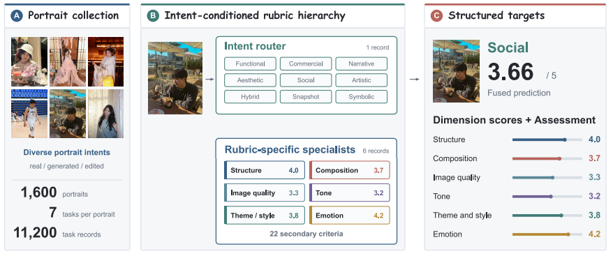
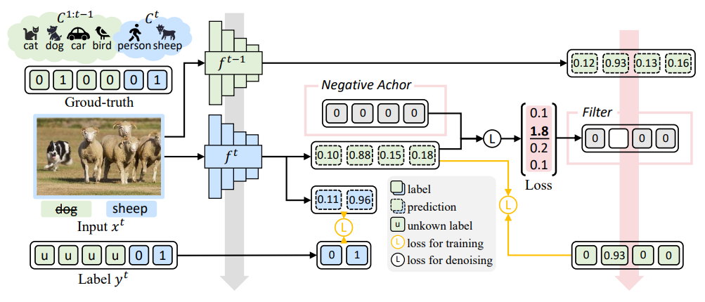
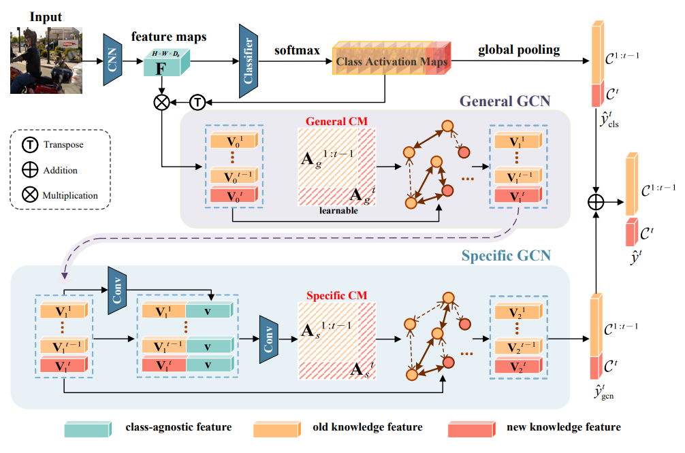
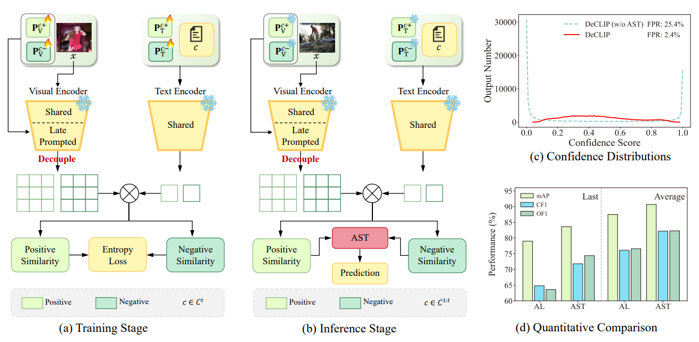
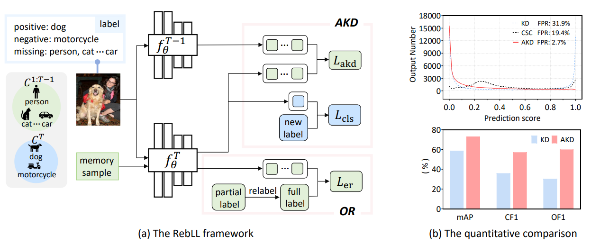

Welcome to Junzhou Xie's academic homepage! I am a master's student at Southeast University. My research focuses on computer vision, multimodal large language models, and multimodal generation, with specific interests in vision-language understanding, portrait image generation, and continual learning.

📧 [Contact](mailto:junzhou.xie@seu.edu.cn)

# 🔥 News
- *2026.10*: &nbsp;🎉🎉 Our preprint **PortraitAes: Intent‑Conditioned Structured Portrait Aesthetic Assessment** is available on arXiv!
- *2026.09*: &nbsp;🎉🎉 Preprint **DeCLIP: Decoupled Prompting for Multi‑Label Class‑Incremental Learning with CLIP** updated on arXiv.
- *2026.07*: &nbsp;🎉🎉 Paper accepted by **Neurocomputing**: *A negative-anchored self-relabeling strategy for multi-label class-incremental learning*.
- *2026.06*: &nbsp;🎉🎉 Paper accepted by **Pattern Recognition**: *Negative-weighted knowledge distillation regularized graph convolutional network for multi-label class-incremental learning*.
- *2024.12*: &nbsp;🎉🎉 Paper accepted by **AAAI 2025**: *Rebalancing Multi‑Label Class‑Incremental Learning*.

# 📝 Publications

arXiv Preprint

**1. PortraitAes: Intent‑Conditioned Structured Portrait Aesthetic Assessment**

**Junzhou Xie**, Haozhong Xiong, Xunyun Tian, Kaile Du, Tianchen Yu, Qiang Li, Wei Liu, Jiaming Liu, Ruihua Huang, Yang Shi, Guangcan Liu.

[📄 Paper](https://arxiv.org/abs/2610.05010) / [💻 Code](https://github.com/junzhouxie/PortraitAes) / [🏠 Project Page](https://portraitaes.github.io/) / [📋 BibTeX](/bibtex/)

**Highlights**
- Propose an intent-conditioned structured portrait aesthetic assessment task.
- Build PortraitAes-Bench with 11K samples, 9 photographic intents and 22 secondary criteria.
- Develop a multi-task model with Gaussian calibration and cross-image ranking.
- Outperform general-purpose MLLMs and aesthetic-specific baselines on standard & hard-case sets.

Neurocomputing

**2. A negative-anchored self-relabeling strategy for multi-label class-incremental learning**

Kaile Du, **Junzhou Xie**, Fan Lyu, Yifan Zhou, Zihan Ye, Guangcan Liu.

[📄 Paper](https://www.sciencedirect.com/science/article/pii/S0925231226016905) / [📋 BibTeX](/bibtex/)

**Highlights**
- Address false-negative label drift in multi-label class-incremental learning (MLCIL).
- Propose a negative-anchored self-relabeling strategy to refine pseudo labels for old classes.
- Maintain stable negative supervision for new classes without extra memory overhead.
- Achieve consistent gains on PASCAL VOC and MS-COCO MLCIL benchmarks.

Pattern Recognition

**3. Negative-weighted knowledge distillation regularized graph convolutional network for multi-label class-incremental learning**

Kaile Du, **Junzhou Xie**, Fan Lyu, Yifan Zhou, Zihan Ye, Wei Li, Yuyang Li, Guangcan Liu.

[📄 Paper](https://www.sciencedirect.com/science/article/pii/S0031320326006229) / [📋 BibTeX](/bibtex/)

**Highlights**
- Introduce GCN to explicitly capture label correlations for MLCIL.
- Design negative-weighted knowledge distillation to mitigate catastrophic forgetting.
- Propagate semantic information across seen categories via label graph topology.
- Validate superior performance on standard multi-label incremental benchmarks.

arXiv Preprint

**4. DeCLIP: Decoupled Prompting for Multi‑Label Class‑Incremental Learning with CLIP**

Kaile Du, Zihan Ye, **Junzhou Xie**, Yixi Shen, Yuyang Li, Fuyuan Hu, Ling Shao, Guangcan Liu, Joost van de Weijer, Fan Lyu.

[📄 Paper](https://arxiv.org/abs/2509.23335) / [📋 BibTeX](/bibtex/)

**Highlights**
- Identify representation entanglement and high false-positive rate in CLIP-based MLCIL.
- Propose replay-free, parameter-efficient DeCLIP with decoupled prompting.
- Introduce Adaptive Similarity Tempering for inference-time false positive suppression.
- Achieve SOTA results on MS-COCO, PASCAL VOC and NUS-WIDEseq benchmarks.

AAAI 2025

**5. Rebalancing Multi‑Label Class‑Incremental Learning**

Kaile Du, Yifan Zhou, Fan Lyu, Yuyang Li, **Junzhou Xie**, Yixi Shen, Fuyuan Hu, Guangcan Liu.

[📄 Paper](https://ojs.aaai.org/index.php/AAAI/article/view/33798) / [📋 BibTeX](/bibtex/)

**Highlights**
- Identify label-level and loss-level positive-negative imbalance in MLCIL.
- Propose RebLL with asymmetric knowledge distillation (AKD) and online relabeling (OR).
- Rebalance loss weights and recover class distribution in memory buffer.
- Achieve new SOTA with vanilla CNN backbone on PASCAL VOC and MS-COCO.

